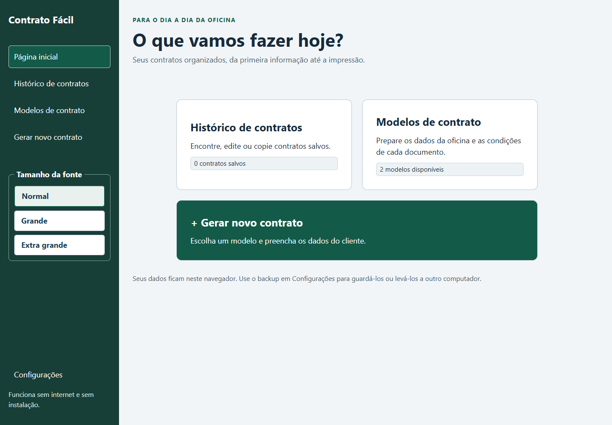

# Contrato Fácil

Aplicativo offline para oficinas criarem contratos de peças, serviços e garantia, com histórico local e modelos reutilizáveis. Preencha os dados, confira o total e imprima ou salve em PDF.

**Um único HTML para o cliente, sem instalação, servidor ou cadastro. A consulta opcional de CEP precisa de internet; as demais funções continuam locais.**



## Entrega e primeiros passos

Envie apenas `index.html` ao cliente. Ele abre o arquivo no navegador e começa a usar. Node.js, npm e os arquivos de desenvolvimento não são necessários para executar o aplicativo.

1. Em **Modelos de contrato**, confira os dados fixos da oficina, as cláusulas e os dados de pagamento.
2. Acesse **Gerar novo contrato** e escolha o modelo desejado.
3. Informe o cliente, o veículo, as peças ou serviços, quantidades e valores unitários.
4. Preencha informações complementares, prazos e revisões, quando necessários.
5. Clique em **Salvar no histórico** ou **Imprimir / salvar PDF**. Na janela de impressão, escolha papel A4 e o destino desejado.

O contrato é salvo antes de abrir a janela de impressão. Cancelar essa janela mantém o registro no histórico; o aplicativo não consegue confirmar se o documento foi efetivamente impresso.

## Página inicial e navegação

A página inicial apresenta dois blocos de consulta — **Histórico de contratos** e **Modelos de contrato** — e um bloco destacado para **Gerar novo contrato**.

O menu fica fixo à esquerda em telas de computador e passa para o topo em telas menores. As configurações ficam na parte inferior do menu. Durante o preenchimento, links âncora levam às seções do contrato.

## Histórico de contratos

Cada registro mostra cliente, modelo do veículo e placa, data/hora de criação, modelo usado e situação. A lista tem busca e paginação.

| Ação | Comportamento |
| --- | --- |
| Editar | Reabre os dados e atualiza o mesmo registro ao salvar, preservando a data de criação. |
| Copiar | Abre um novo preenchimento com os dados do original. Outro registro só é criado ao salvar. |
| Excluir | Remove o registro após confirmação. |

O histórico guarda os dados necessários para gerar novamente o documento, e não o arquivo PDF binário. Cada contrato mantém uma cópia do modelo utilizado: editar ou excluir um modelo não muda contratos já salvos.

## Modelos de contrato

Modelos podem ser criados, editados, copiados, excluídos e usados para iniciar um contrato. A listagem usa títulos maiores e ações por extenso.

O editor reúne nome e formato do modelo, dados fixos da oficina, informações bancárias e Pix, texto de abertura, cláusulas e opções do recibo. Mudanças feitas no navegador não alteram o arquivo HTML: use um backup para transferi-las a outro computador.

### Modelos iniciais Shekinah

Os dois modelos foram reconstruídos em HTML/CSS a partir dos PDFs e das cinco fotografias fornecidos:

| Modelo | Conteúdo |
| --- | --- |
| Prestação de serviço — Shekinah | Oficina, cliente, veículo, tabela de itens, cláusulas 1 a 16, pagamento e assinaturas. |
| Garantia e revisões — Shekinah | Termo de garantia, nota de serviço executado, três cupons de revisão e recibo de retirada opcional. |

O recibo está habilitado inicialmente no modelo de garantia e pode ser desativado em suas opções. As revisões recebem valores iniciais editáveis. Os intervalos padrão são somados à quilometragem informada em cada contrato.

As fotografias legíveis foram consideradas na transcrição. A cláusula 16 adicional do PDF de garantia foi preservada. Como as fotografias não mostram outra chave Pix, foram mantidos os dados bancários do PDF de prestação de serviço, disponíveis para edição no modelo.

Nomes, documentos, placas, valores e assinaturas dos clientes dos exemplos não são dados iniciais do aplicativo. Os PDFs e as fotografias originais não foram adicionados ao repositório.

Os modelos iniciais são carregados quando ainda não há dados locais. Atualizar o HTML não sobrescreve modelos já salvos neste navegador.

### Campos automáticos

As cláusulas podem usar os seguintes marcadores, substituídos pelos dados do contrato na impressão:

- Valor: `{{total}}` e `{{valorExtenso}}`.
- Prazos: `{{prazoNacional}}` e `{{prazoDiesel}}`.
- Revisões: `{{revisao1}}`, `{{revisao2}}` e `{{revisao3}}`.
- Oficina e pagamento: `{{empresa}}`, `{{banco}}`, `{{agencia}}`, `{{conta}}`, `{{titular}}` e `{{pix}}`.

O valor por extenso é digitado pelo usuário. Campos opcionais não informados aparecem como espaços para preenchimento manual.

## Preenchimento rápido e acessibilidade

- Três tamanhos de fonte: **Normal**, **Grande** e **Extra grande**.
- Rótulos nos campos, foco visível, botões grandes e operação por teclado.
- Uma seção de preenchimento aberta por vez e apenas um editor aberto em cada lista.
- Peças e cláusulas em páginas de cinco registros, com resumos para revisão.
- Botões de adicionar em barras que acompanham a rolagem da seção.
- Novos registros abertos automaticamente, com foco no campo de preenchimento.
- Validação que revela a seção, a página e o editor do primeiro campo incorreto.
- Subtotais e total em reais, calculados em centavos.
- Sinalização de alterações não salvas e confirmação antes de substituir um preenchimento em andamento.

## Catálogo de peças

O catálogo local contém 65 peças e insumos comuns, incluindo nomes alternativos. Digite pelo menos duas letras para receber até seis sugestões. A busca ignora acentos e maiúsculas e usa distância de edição para tolerar pequenos erros, como `cabesote` e `virabrequin`.

Use **↑ / ↓** e **Enter** para selecionar, **Esc** para fechar ou o mouse para clicar. O texto é livre: serviços e peças fora do catálogo também podem ser usados.

O catálogo sugere nomes, sem definir preços ou verificar compatibilidade com veículos. Para ampliá-lo, edite o bloco JSON `catalogoPecas` em `index.html`.

## Configurações, armazenamento e backup

As configurações incluem quatro paletas de alto contraste, cantos arredondados ou discretos, espaçamento das listas e modelo padrão para novos contratos. Cores, espaçamento e tamanho de fonte alteram a tela; os documentos continuam em preto e branco.

Modelos, contratos e preferências ficam em `localStorage`, no navegador e endereço em que o HTML foi aberto. A consulta opcional de endereço envia somente o CEP ao ViaCEP. Contratos, dados dos clientes e modelos não são enviados ao serviço.

**Exporte backups regularmente em Configurações.** Limpar os dados do navegador, mover o HTML ou mudar de computador pode tornar os dados locais indisponíveis.

O backup JSON inclui contratos, modelos e preferências, mas não alterações ainda não salvas. Ele contém dados dos clientes e deve ser guardado em local adequado. A restauração valida o arquivo e pede confirmação antes de substituir os dados atuais.

Falhas de leitura ou gravação são informadas sem anunciar um salvamento inexistente. Dados locais inválidos não são sobrescritos automaticamente. Alterações em outra aba bloqueiam novas gravações até recarregar ou restaurar, evitando sobrescrever versões diferentes.

## Impressão e PDF

Os documentos usam papel A4 e margens de 15 mm. A interface fica oculta na impressão. Todos os itens e cláusulas são incluídos, mesmo em seções fechadas ou outras páginas da tela. A tabela repete seu cabeçalho quando necessário.

O estilo de impressão usa caixas de margem vazias para remover data/hora, título do aplicativo, URL e paginação automáticos do navegador. Essa saída foi validada no Chrome 156 com a opção de cabeçalhos e rodapés ligada e desligada. Em outros navegadores ou configurações personalizadas, pode ser necessário desmarcar **Cabeçalhos e rodapés** em **Mais configurações**.

A paginação se adapta ao conteúdo. Na amostra conferida, o modelo de prestação de serviço ocupou duas páginas, e o de garantia ocupou cinco com o recibo habilitado. Itens extensos ou cláusulas maiores podem acrescentar páginas. A janela de impressão permite escolher quais páginas imprimir.

## Desenvolvimento

O código usa HTML semântico, CSS local e APIs nativas do navegador, seguindo as skills de código limpo e layout acessível em `.agents/skills/`. Os textos do usuário são inseridos no documento com `textContent`, sem execução de HTML.

```text
index.html          Aplicativo, catálogo e modelos iniciais embutidos
.agents/skills/     Diretrizes locais de desenvolvimento
tests/              Testes de fluxo no navegador
docs/               Imagem da interface para documentação
package.json        Comandos e dependências de desenvolvimento
```

### Testes

Com Node.js 20 ou superior e Google Chrome instalado:

```sh
npm ci
npm test
```

Os testes com Playwright verificam busca e teclado, cálculos, validação, listas extensas, CRUD de modelos e contratos, preservação do histórico, backup e restauração, falhas de armazenamento, segurança dos textos e impressão com e sem cabeçalhos automáticos.

Também cobrem fonte ampliada, rótulos e ausência de rolagem horizontal em 375, 768, 1200 e 1440 pixels. Os dois modelos foram renderizados e conferidos visualmente. A verificação automatizada não substitui testes com leitores de tela nem a conferência da impressora usada pela oficina.

## Limitações atuais

- Os dados não são sincronizados entre computadores ou navegadores; a transferência é feita por backup.
- O preenchimento em andamento precisa ser salvo antes de fechar a página.
- A quantidade aceita unidades inteiras; o preço unitário aceita duas casas decimais, inclusive zero.
- O catálogo é ampliado manualmente e pode sugerir peças diferentes da desejada.
- A geração usa a janela de impressão do navegador; não há download automático nem confirmação física da impressão.

## Consulta de endereço por CEP

O CEP é o primeiro campo de endereço no contrato (oficina e cliente) e no editor do modelo. Ao completar oito números, o aplicativo consulta o [ViaCEP](https://viacep.com.br/) e preenche logradouro, bairro, cidade e UF. O botão **Buscar endereço** permite tentar novamente. Confira e acrescente o número do imóvel.

A consulta mostra carregamento, sucesso, CEP não encontrado, erro de conexão ou tempo esgotado. Não apaga o endereço em caso de erro nem substitui campos corrigidos durante uma consulta. Respostas de consultas antigas são descartadas ao trocar o CEP ou abrir outro contrato/modelo.

Somente a busca por CEP precisa de internet e envia o CEP ao ViaCEP, sem dados do cliente, credenciais ou informações do contrato. O preenchimento manual e as demais funções continuam disponíveis offline. Não há consultas automáticas ao simplesmente abrir contratos já salvos.

## Revisões com valores iniciais

Novos contratos começam com intervalos de **1.000, 4.000 e 7.000 km** e valor de **R$ 850,00 por revisão**, com base nos exemplos fornecidos. Ajuste esses padrões em Configurações para os valores praticados pela oficina.

Ao informar a quilometragem atual, os intervalos são somados automaticamente: com 241.025 km, as revisões ficam em 242.025, 245.025 e 248.025 km. Sem leitura informada, a base é zero. Confira os valores antes de imprimir.

Uma revisão alterada manualmente deixa de acompanhar o cálculo automático naquele preenchimento. Contratos reabertos ou copiados preservam as quilometragens e o preço registrados, mesmo que os padrões das configurações tenham mudado. Os novos campos são opcionais na validação de backups antigos, mantendo a compatibilidade com os dados já salvos.

## Pesquisa de consulta por placa

A pesquisa e os requisitos de integração estão em [Consultas externas](docs/consultas-externas.md). A API Placas oferece consultas por placa, mas exige conta e token mantido em um serviço externo. A consulta veicular remota não foi ativada no HTML; o preenchimento dos dados do veículo permanece manual.

Os testes adicionais usam respostas controladas do ViaCEP para verificar carregamento, preenchimento, falhas, ausência de internet, tempo limite, respostas atrasadas e preservação de edições. Também verificam os padrões de revisão e a leitura de dados antigos. Uma consulta real ao CEP público de exemplo `01001-000` foi conferida no Chrome, abrindo o HTML diretamente como arquivo local.
